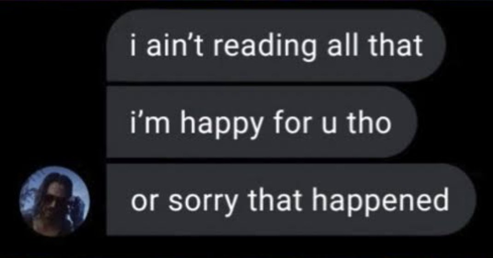

# reaction vault

Images I quote way too often. Now with permanent links.

## i ain't reading all that

[Open image](images/i-aint-reading-all-that.png) · [Direct link](https://raw.githubusercontent.com/esworde/reaction-vault/main/images/i-aint-reading-all-that.png)

## Adding to the vault

Drop an image into `images/` with a descriptive, lowercase, hyphenated filename, then add its preview and direct link here.
